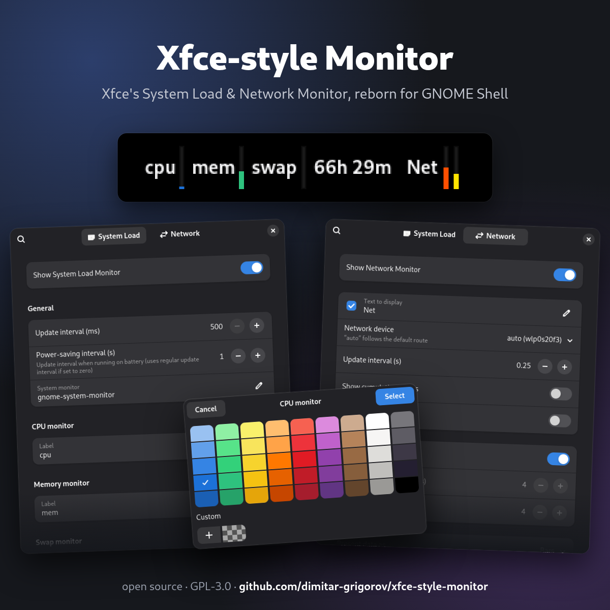
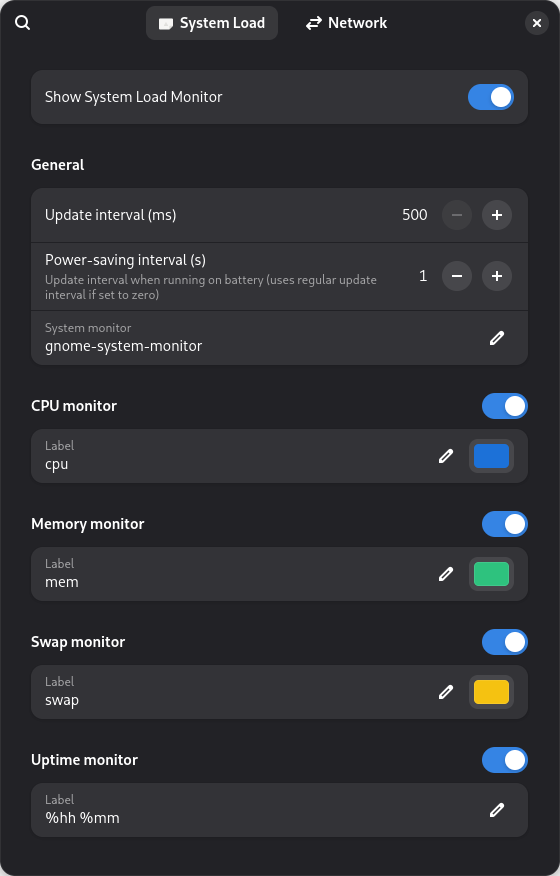
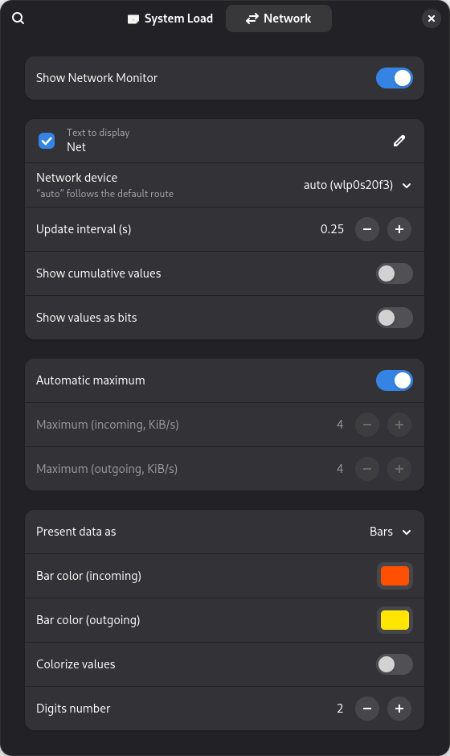

# Xfce-style Monitor

The **System Load Monitor** and **Network Monitor** panel plugins of Xfce, for GNOME Shell: thin
bars with text labels for CPU, memory and swap, uptime, and network in/out. Two independent
indicators, in the top bar or in Dash to Panel. Nothing else to install. GNOME 48.

<p align="center">
  
</p>

Hover for details (memory used, rates, IP address), left-click System Load to open the system
monitor, right-click either for its settings.

## Install

**From a release** — download `xfce-style-monitor@grigorov.shell-extension.zip` from
[Releases](../../releases), then:

```sh
gnome-extensions install --force xfce-style-monitor@grigorov.shell-extension.zip
```

**From source:**

```sh
git clone https://github.com/dimitar-grigorov/xfce-style-monitor.git
cd xfce-style-monitor
scripts/dev.sh link
```

Then log out and back in (GNOME on Wayland loads new extensions only at login) and turn it on in
the Extensions app, or with `gnome-extensions enable xfce-style-monitor@grigorov`.

## Credits

Look, behaviour, defaults and texts come from the Xfce panel plugins:

- [xfce4-systemload-plugin](https://gitlab.xfce.org/panel-plugins/xfce4-systemload-plugin) (BSD-2-Clause)
- [xfce4-netload-plugin](https://gitlab.xfce.org/panel-plugins/xfce4-netload-plugin) (GPL-2.0-or-later)

How it's done inside GNOME Shell follows
[GNOME Shell](https://gitlab.gnome.org/GNOME/gnome-shell) itself (level bars, panel buttons), the
System Monitor extension of
[gnome-shell-extensions](https://gitlab.gnome.org/GNOME/gnome-shell-extensions),
[Astra Monitor](https://github.com/AstraExt/astra-monitor) (reading `/proc`) and
[Dash to Panel](https://github.com/home-sweet-gnome/dash-to-panel) (preferences).

An independent project, not affiliated with or endorsed by the Xfce or GNOME projects.

## Development

```sh
scripts/dev.sh                # nested GNOME Shell in a window; close it and rerun after a change
scripts/dev.sh prefs          # the same, with the preferences open
tests/run.sh                  # unit tests (gjs, no shell needed)
npm install && npx eslint .   # lint
scripts/pack.sh               # dist/<uuid>.shell-extension.zip; -i also installs it
```

A tag `vX` (with a `[X]` section in CHANGELOG.md) makes GitHub build the zip and publish a
release with it.

The nested shell shares dconf with your session: other extensions and this one's settings are
the real ones.

```
src/                    the extension itself, what the zip contains
  extension.js          creates/destroys the two indicators per settings
  prefs.js, prefs/      preferences: one page per indicator, as Xfce's two dialogs
  lib/sources/          readers: /proc and /sys text → plain numbers (no St, no timers)
  lib/netload.js        netload's averaging and automatic maximum
  lib/format.js         units, uptime format
  lib/widgets/          bar, value label, tooltip — know nothing about CPU or network
  lib/indicators/       the two panel buttons: timer, settings, sources → widgets
scripts/                dev.sh (nested shell), pack.sh (zip)
tests/                  unit tests
screenshots/            README images; xfce-original-panel.png is the Xfce original the sizes come from
```

Deliberate differences from the Xfce plugins are commented where they are, starting with `XFCE:`;
`grep -rn 'XFCE:' --include=*.js --include=*.css --include=*.xml .` lists them.

## Screenshots

The panel with the default settings:

<p align="center">
  
</p>

| System Load | Network |
|---|---|
|  |  |

## License

GPL-3.0-or-later.
